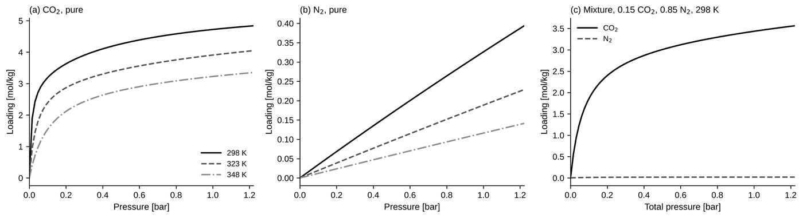
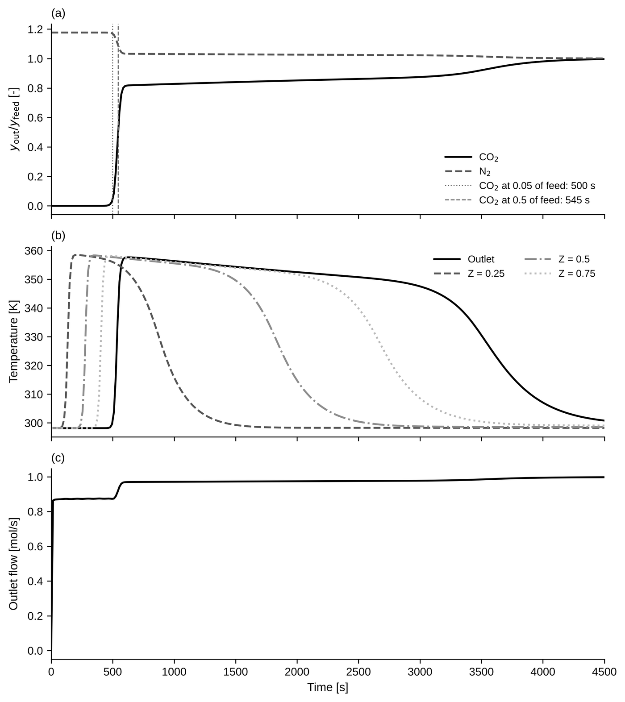
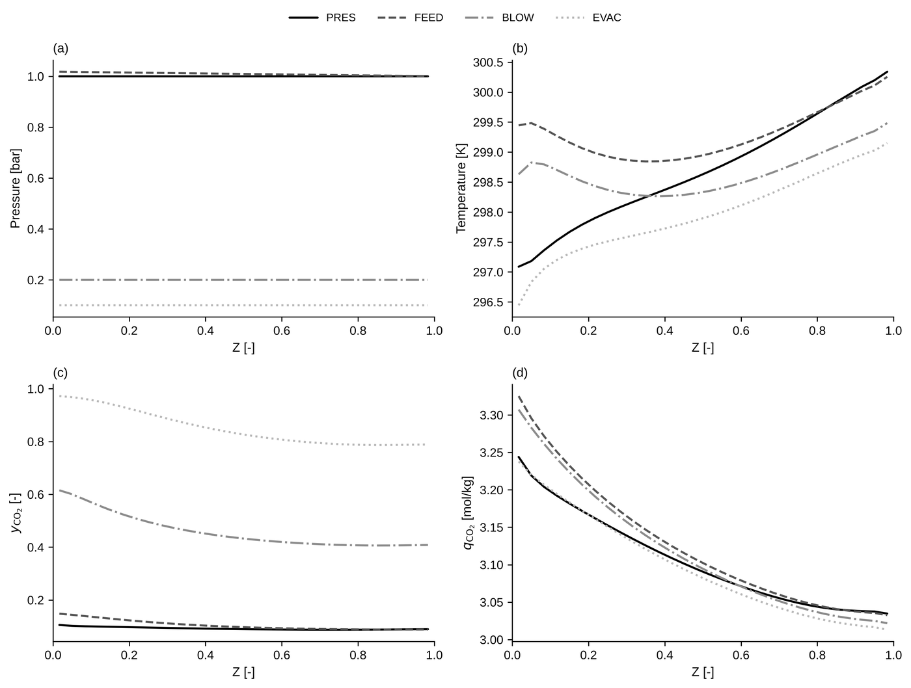
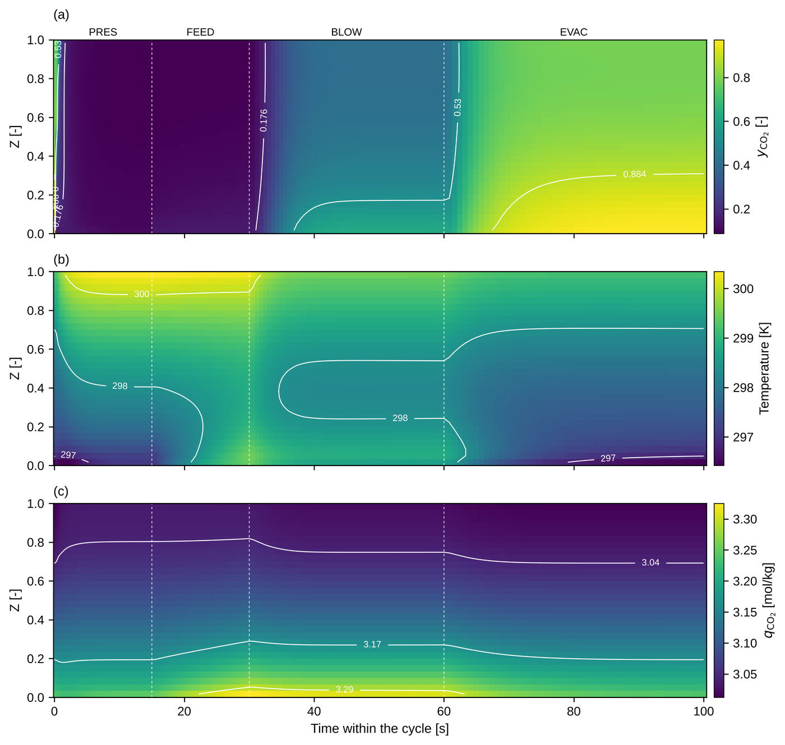
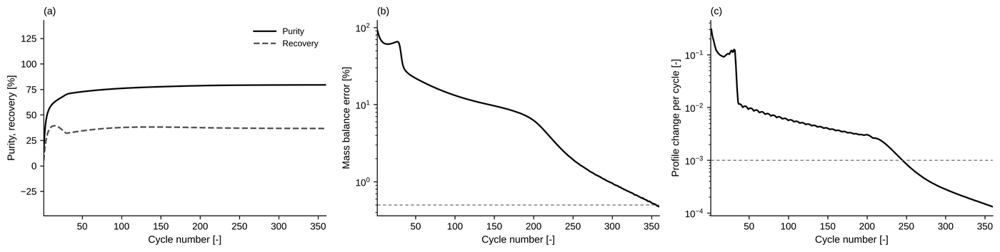
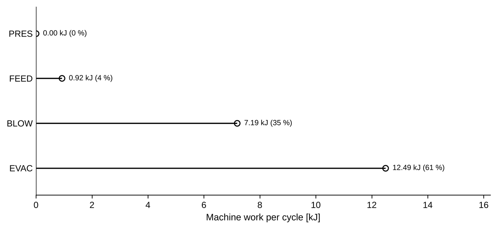

# Outputs and figures

Every simulation can be reported in one call: the numbers as CSV files, the standard figures of adsorption processes as PNG and PDF (with matplotlib, `pip install matplotlib`), and `Summary.md`, a readable summary.

```python
from swingpy.report import report_breakthrough, report_run

report_breakthrough(model, result, "Output/Breakthrough")    # a single feed step
report_run(model, run, "Output/Cycle")                       # a cycle run (Cycle.run)

problem.report(run, "Output/Cycle")                          # the same for a specification (swingpy.spec)
```

The figures below come from `tools/Make gallery.py`: a breakthrough and a four-step VSA cycle on zeolite 13X (`examples/specs/VSA zeolite 13X flue gas.yaml`).

## Numbers (`swingpy.analysis`, no matplotlib needed)

| Function | Content |
|---|---|
| `breakthrough_metrics(model, result, component)` | times at which the outlet reaches 5, 50 and 95 % of the feed mole fraction, stoichiometric time, amount retained (exact), dynamic capacity, mass transfer zone, peak outlet temperature |
| `step_table(model, results)` | per step: duration, pressures at both ends, moles of each component through each end, stream labels, machine work, heat through the wall |
| `cycle_summary(model, run)` | purity, recovery, specific energy, productivity, cycle time, balance error, profile change, composition of every stream |
| `stream_table`, `convergence_table`, `profile_table`, `cycle_history_table` | streams per cycle; KPIs of every cycle; profiles at the end of every step; time series of one cycle at chosen positions and at both ends |
| `end_flows(model, result, end)`, `column_profiles(model, state)` | flows and composition crossing an end; profiles of one state |
| `export_run(model, run, folder)`, `export_breakthrough(model, result, folder)` | all of the above as CSV files |

Flows are in mol/s and positive out of the column, pressures in bar, temperatures in K, loadings in mol/kg.

## Figures (`swingpy.plotting`)

All figures share one journal style (`apply_style()`): open axes, outward ticks, no grid, Arial-metric sans serif type, frameless legends, titles in regular weight with the panel letter on the same line, PNG at 300 dpi plus a vector PDF.

- **Curves computed by the model** are lines only, told apart by grey level (black, `#555555`, `#8C8C8C`, `#B8B8B8`) and line style (`series_style(i)`); a lone curve is solid black (`single_style()`).
- **Measured or published values** are the only points: open markers with no fill (`open_marker_style(i)`), so model and data can never be mistaken for each other.
- **Time histories** separate the steps with dotted lines and the cycles with dashed ones, name the steps above the axes, and carry no shading.
- **Quantities per step or per kind of energy** are lollipops: a thin stem from zero to an open marker, one row per step.
- **Position-time maps** use the viridis scale (Crameri, Shephard and Heron, *Nat. Commun.* 11 (2020) 5444: perceptually uniform, readable in grey) with white contours at 10, 50 and 90 % of the range and always a colour bar.

### Step codes

Every step has a four-letter code (`STEP_CODES`, `step_meaning(code)`); steps of the same kind are numbered in the fourth place.

| Code | Step | Code | Step |
|---|---|---|---|
| `PRES` | pressurization | `HREF` | heavy reflux |
| `FEED` | feed (adsorption) | `HEAT` | heating |
| `BLOW` | blowdown | `COOL` | cooling |
| `EVAC` | evacuation | `HEVA` | heating under evacuation |
| `PURG` | purge | `DESO` | desorption |
| `LPPR` | light product pressurization | `DEPR` | co-current depressurization |
| `EQDN` | pressure equalization, donor | `RINS` | rinse |
| `EQUP` | pressure equalization, receiver | `RECY` | recycle |
| `LREF` | light reflux | `SUPP` | supply of purge to another column |
| `IDLE` | idle | `EQD1`, `EQU2`, `HEA1` | numbered steps of one kind |

### Equilibrium

`plot_isotherms(adsorbent, components, temperatures, max_pressure, path, composition=...)`: pure-component isotherms at several temperatures and the competitive loadings of a mixture.



### Breakthrough

`plot_breakthrough(model, result, path)`: outlet mole fractions relative to the feed with the breakthrough times, temperatures at the outlet and inside the column, outlet flow.



`plot_step_profiles(model, result, path)`: the column at several moments of one step, here the fronts moving through the bed.


### Cycle at steady state

The four-step cycle of the same example, run with plain cycles from a column filled with nitrogen at 0.1 bar: cyclic steady state (mass balance error below 0.5 % and profile change below 10<sup>−3</sup> for five cycles in a row) after 360 cycles, purity 79.39 %, recovery 36.64 %.

`plot_all(model, run.recent, run.history, prefix)` draws all of these; the file names follow the prefix (a folder when it ends with `/`).

| File | Content |
|---|---|
| `Profiles` | pressure, temperature, mole fraction and loading along the column at the end of each step |
| `Feed step profiles` | the column at several moments of the feed step |
| `Cycle pressure` | pressure at both ends over one cycle (the cycle diagram) |
| `End flows` | molar flow of every component through both ends |
| `End compositions` | composition of the gas leaving each end (the outlet analyser traces) |
| `Step balance` | moles of each component through each end in every step |
| `Maps` | mole fraction, temperature and loading over position and time |
| `Last cycle`, `Last three cycles`, `Last ten cycles` | histories at chosen positions (thermocouples) |
| `Convergence` | purity, recovery, mass balance error and profile change per cycle |
| `Energy` | compressor and pump work of each step |











