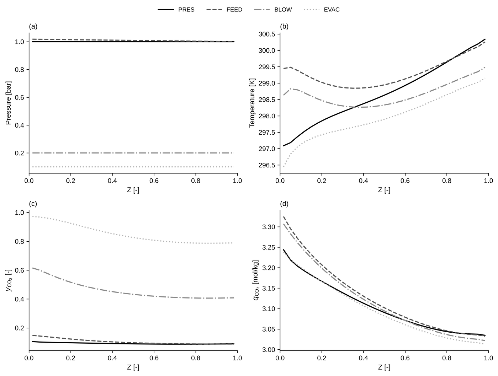

# SwingPy

**SwingPy** is a Python library for the simulation of pressure, vacuum and vacuum-pressure swing adsorption cycles (PSA, VSA, VPSA). It solves a one-dimensional, nonisothermal and nonisobaric column model with any number of gas components, and runs cycles built from simple steps to cyclic steady state, with their purity, recovery, energy and productivity.

## What it does

- **Column model**: axially dispersed plug flow, linear driving force uptake, bed and wall energy balances, Darcy or Ergun pressure drop; finite volumes with WENO or flux-limited schemes, solved by a stiff integrator with a sparse Jacobian (optionally compiled with numba).
- **Equilibrium**: competitive dual-site Langmuir, Sips and Toth isotherms, on a concentration or partial pressure basis.
- **Cycles**: every step is two boundary conditions, one per column end: feed, pressurization, blowdown, evacuation with vacuum pumps, purge, light product pressurization, light and heavy reflux, pressure equalization. Steps can end on a pressure. Recorded streams couple steps in one column to stand for a multi-bed plant.
- **Results**: purity, recovery, energy and productivity from exact running integrals, mass and energy balance errors, cyclic steady state on both the mass balance and the column profiles, and a full set of figures.
- **Data**: a bank of adsorbents and gases, extensible with your own files.

## Where to start

- [Installation](installation.md)
- [Quick start](quickstart.md): a breakthrough and a VSA cycle in a few lines
- [User guide](guide/model.md): the model and every part of the library
- [API reference](api/model.md)
